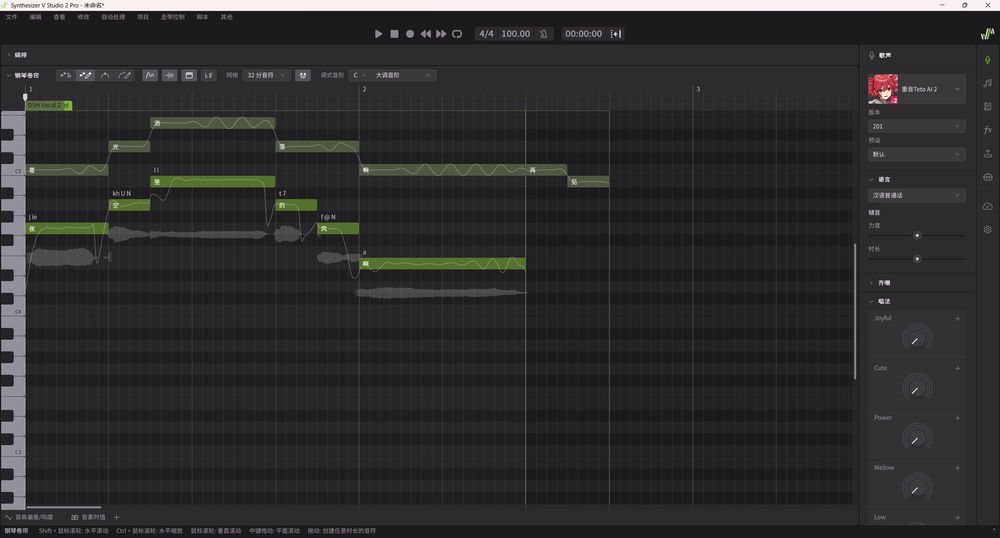

# dsh-synthv-studio

**A DSH plugin that finds a local Synthesizer V Studio 2 Pro, drives it through
its own Lua scripting API, and gives the agent five tools for discovery, a
persistent bridge, vocal composition, note editing and DAW integration.**

[中文](README.zh.md) | English

[](LICENSE)
[](https://github.com/deepseek-ai/deepseek-harness)
[](#requirements)
[](#requirements)



Synthesizer V Studio 2 Pro has no external API: it exposes **in-app Lua
scripts** and a **VST3/ARA plug-in**. This plugin turns the script API into
agent-callable tools by combining a persistent Lua executor, file-based IPC and a
bundled local MCP server. It never parses or rewrites `.svp` project files, never
opens a network port and never calls an online service — Synthesizer V remains
the only authority for project state.

## Requirements

- **Windows 10/11** (developed and verified on Windows 11; discovery and DAW
  probing are Windows-specific).
- **Synthesizer V Studio 2 Pro 2.1.2 or newer**, installed normally, with a
  project open. Verified with 2.2.1.
- **DeepSeek Harness with `dsh` ≥ 0.2.0-rc.1** (verified on the 0.2.0-rc.2
  runtime shipped with DSH Desktop Next 2.0.17-next).
- Node.js 20+ available to the DSH Host (the bundled bridge server is a plain
  Node script).
- Optionally any VST3 host (REAPER, Zrythm, Cubase, Studio One, …) for DAW work.

## Install

Install the bundle into a DSH profile:

```sh
dsh plugin --profile desktop add github:Making-acid/dsh-synthv-studio
```

(or `--profile web` for the web profile). Restart DSH once after installing so
the Host plugin loads; the bundle is then listed under Settings → Plugins and the
five tools appear in new sessions.

> An npm package is planned. The `dsh` install command will become
> `dsh plugin add dsh-synthv-studio` once it is published; the GitHub install
> above works today.

## First connection (once per SynthV launch)

1. In DSH, call `synthv_bridge` with `{ "action": "ensure" }`. On first use the
   plugin writes the bridge scripts into
   `%APPDATA%\Dreamtonics\Synthesizer V Studio 2\scripts\SynthV Agent Bridge\`.
2. In Synthesizer V, choose **Scripts → Rescan** once, then
   **Scripts → SynthV Agent Bridge → Start SynthV Agent Bridge** and leave it
   running.
3. Call `synthv_bridge` with `{ "action": "ensure", "waitSeconds": 30 }` again.
   A healthy bridge reports `connected`, a fresh heartbeat, and
   `coherence.state = "matched"`.

The bridge is a SynthV script, so it stops with SynthV and must be started again
after the next launch. If a previously installed bridge was built from an older
template, `ensure` hot-reloads it instead of asking you to restart.

## Tools

| Tool | What it does |
|---|---|
| `synthv_detect` | Read-only scan: install directory and version, license session, voice database, VST3 + ARA bundles, installed DAWs, bridge heartbeat and IPC directory. |
| `synthv_bridge` | `status` / `install` / `ensure` / `launch` / `stop` / `reload` / `uninstall`: installs the bundled Lua scripts, repairs a stale running bridge by hot reload, checks build coherence, starts Synthesizer V. |
| `synthv_compose` | Writes a vocal phrase: tempo, track name, notes with lyrics, dedicated or reused note group, then an independent read-back check. `dryRun` plans without writing. |
| `synthv_do` | Calls the bridge's own MCP tools: `sv_status`, `sv_describe`, `sv_query`, `sv_command`, `sv_ui`, `sv_review`. The bridge exposes 17 read actions, 38 write actions and 9 UI actions over notes, lyrics, phonemes, pitch controls, automation, voices/vocal modes, mixer and playback. |
| `synthv_daw` | `detect` / `verify` / `export_midi` / `write_guide`: DAW detection, VST3/ARA verification, DAW plugin-cache evidence, Standard MIDI File export and a generated integration guide. |

Notes for `synthv_compose`: `onset` and `duration` are in **quarter-note beats**,
`pitch` is a **MIDI note number**, `lyric` is one syllable.

```json
{
  "tempoBpm": 104,
  "trackName": "Lead Vocal",
  "groupName": "Lead Vocal",
  "notes": [
    { "onset": 0,   "duration": 1,   "pitch": 72, "lyric": "星" },
    { "onset": 1,   "duration": 0.5, "pitch": 74, "lyric": "光" },
    { "onset": 1.5, "duration": 1.5, "pitch": 76, "lyric": "洒" },
    { "onset": 3,   "duration": 1,   "pitch": 74, "lyric": "落" },
    { "onset": 4,   "duration": 2,   "pitch": 72, "lyric": "啊" }
  ]
}
```

For advanced editing, call `synthv_do` with `sv_describe` first to read the exact
action schema, then `sv_query` with `contextMode: "writeIntent"` to obtain a
`contextId`, then `sv_command`. Every write is verified against SynthV's current
state by the bridge.

## How it works

```text
DSH agent
   │  five synthv_* tools
   ▼
dsh-synthv-studio (Host plugin, lib/)
   │  MCP over stdio (child process)
   ▼
server/server.bundle.mjs  (SynthV Agent Bridge server, bundled)
   │  JSON file IPC in %TEMP%
   ▼
SynthV Agent Bridge (in-app Lua executor, SV:setTimeout polling)
   │  Synthesizer V's official Lua script API
   ▼
Synthesizer V Studio 2 Pro  ──▶  VST3 / ARA plug-ins  ──▶  DAW
```

The Lua executor and the Node server share a content-derived build id
(`sv3-lua-<version>-<sha256(template)>`). The plugin injects it at install time
and writes the install manifest the executor uses to locate itself for hot
reload, so the two halves can never disagree silently.

## DAW integration

Synthesizer V Studio 2 Pro ships a **VST3 instrument plug-in** and a **VST3 ARA
plug-in**. Typical workflow:

1. Insert `Synthesizer V Studio 2 Plugin` on an instrument track in your DAW.
2. Export a melody with `synthv_daw { "action": "export_midi", "bpm": 104, "notes": [...] }`
   and drag the `.mid` onto that track, or draw MIDI in the DAW.
3. Write lyrics and tuning in the plug-in (or compose in the desktop app with
   `synthv_compose` and save the project).
4. Render/export from the DAW; the vocal follows the arrangement.
5. Need a finished audio file? Render from the Synthesizer V desktop app and
   import the WAV.

`synthv_daw { "action": "write_guide" }` writes a machine-specific Markdown guide
with the detected plug-in paths and DAW steps.

## Limitations

- **Voice selection is manual.** The scripting API can neither read the current
  singer nor enumerate installed singers, so you must pick one for the note group
  in Synthesizer V's Voice panel before listening.
- **Save and render stay in the GUI.** The official API cannot save the project
  or render audio; `.svp` files are never touched by this plugin.
- **The bridge lives inside SynthV.** It stops when SynthV closes and has to be
  started from the Scripts menu after the next launch.
- **Windows only.** macOS/Linux paths, process checks and DAW discovery are not
  implemented.
- One `synthv_compose` call targets one track. For multi-track work, create
  tracks with `synthv_do` (`sv_command`, action `add_track`) and address them via
  `trackIndex`.

## Tests

```sh
node test/selftest.mjs          # offline: plugin surface, schemas, pure logic
node test/mcp-handshake.mjs     # offline: bundled server MCP handshake
node test/e2e-synthv.mjs        # needs SynthV + bridge; dry run by default
node test/e2e-synthv.mjs --write
```

Real-machine results are recorded in [docs/verification.md](docs/verification.md).

## License and credits

Apache-2.0. The bundled bridge server (`server/server.bundle.mjs`) and the
in-app Lua scripts (`synthv/*.lua`) are vendored from
[SynthVCopilot/synthv-agent-bridge](https://github.com/SynthVCopilot/synthv-agent-bridge)
(Apache-2.0) — see [NOTICE](NOTICE) for provenance and the build-id injection this
plugin performs. “Synthesizer V” is a product of Dreamtonics Co., Ltd.; this
project is not affiliated with Dreamtonics.
